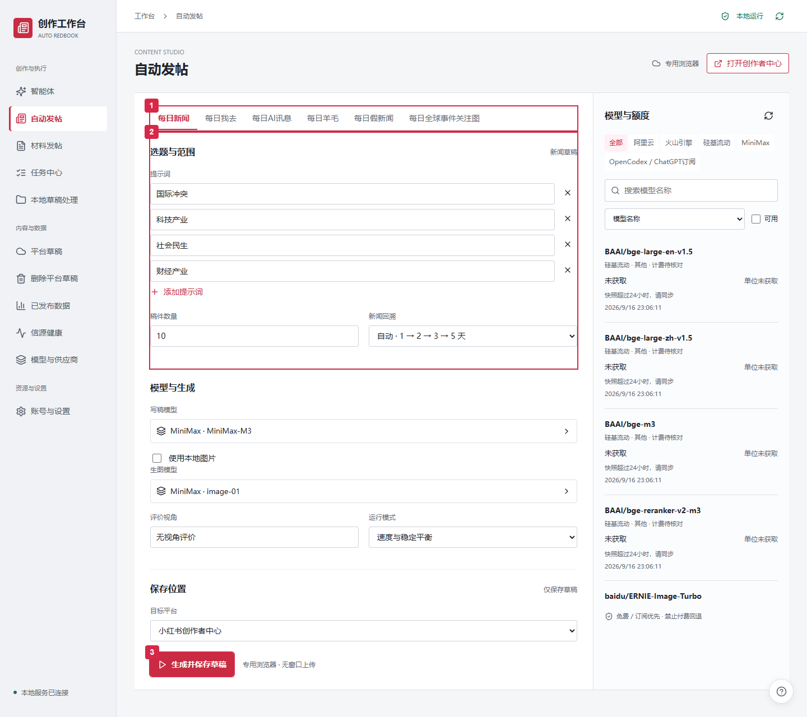
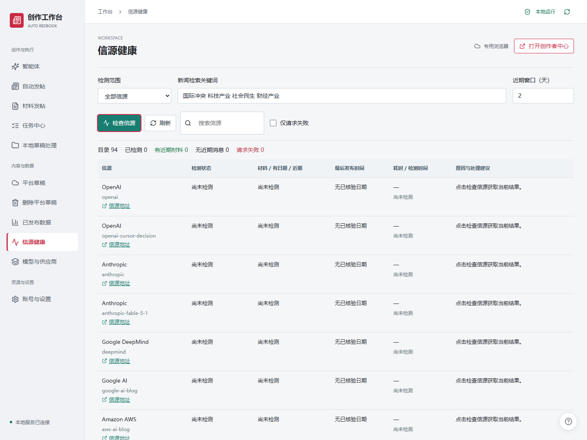

# Auto Redbook · 创作工作流

用表单或命令行完成新闻采集、图文生成、审查和平台草稿保存。React + Vite 工作台与 Python 工具适合人工分步操作，也可作为智能体的领域工具。

> 更新核对：2026-10-24。推荐 Windows 本地、E 盘运行。源码不包含 API Key、账号登录态、数据库、模型账号、参考图库或已经生成的稿件。

需要独立对话程序时使用 [采编智能体](https://github.com/bty3052771076-tech/redbook_auto_agent)。工作流位于 `redbook_workflow`，独立智能体位于 `redbook_agent`，智能体运行数据位于 `redbook_runtime`。两个仓库可以分别使用，代码修复不会自动双向同步。

## 1. 功能

| 功能 | 输出 / 用途 | 入口 |
| --- | --- | --- |
| 每日新闻 | 多信源筛选，生成事件正文、评价和 AI 配图 | 自动发帖、CLI |
| 每日 AI 讯息 | 模型/厂商动态，按时效、热度、查重筛成集合稿 | 自动发帖、CLI |
| 每日我去 | 可核验的反常新闻与戏谑评价，带栏目标识 | 自动发帖 |
| 每日羊毛 / AI 鸡蛋 | 可领取 AI 福利，参考图与厂商人设描改 | 自动发帖、参考图库 |
| 每日全球事件关注图 | 有信源、日期与坐标的事件地图 | 自动发帖子栏目 |
| 每日假新闻 | 虚构内容栏目，与真实新闻区分使用 | 自动发帖 |
| 材料发帖 | 自备文字/文件转图文，无需重新搜索事件 | 材料发帖 |
| 草稿处理 | 本地审查、平台草稿读取/筛选、显式确认后删除 | 本地草稿处理、平台草稿 |
| 草稿分发 | 专用 profile 串行保存小红书/今日头条草稿并回读 | 生成并保存草稿、CLI |
| 已发布数据 | 同步可采集的账号/笔记指标，辅助后续选题 | 已发布数据 |
| 模型与供应商 | 写稿/生图选择，供应商、模型与费用配置 | 模型与供应商 |
| 信源健康 | 检查逐源请求、近期材料、耗时和错误 | 信源健康、`check-sources` |
| 快速引导 | 指向具体操作位置，随时重新进入 | 右下角帮助按钮 |

默认新闻主题为“国际冲突、科技产业、社会民生、财经产业”，支持用户替换。自动回溯按 **1 → 2 → 3 → 5 天**扩展；采集目标不是必须凑齐的发布数量。普通正文目标 150–220 字，复杂事件最多 300 字，评价目标 50–100 字；超长内容重新总结。

AI 讯息只保留北京时间生成日和前一日的可核验材料，平台正文不超过 **800 字符**，一篇集合稿可含 1–20 项资讯；当前默认不再强制同一信源最多两条，仍做事件与历史查重。新闻生图失败不会静默换成图库图片；AI 讯息图片由本地卡片渲染。

## 2. 当前局限与待修正

| 局限 | 当前使用方式 / 改进方向 |
| --- | --- |
| 不同模型的推理参数、输出上限、JSON 格式、超时和限流不同 | 更换供应商或模型后先测试能力，再用小批次验证；不能只改模型名就假定表现相同 |
| 订阅额度充足仍可能限流或排队 | 禁止按量付费回退不代表无限请求；以真实响应和本地限流策略为准 |
| 国外信源可能超时、429/403、缺日期或仅转载旧消息 | 先看信源健康；有返回不等于能成稿，无新消息不等于接口失效 |
| 内容审查仍可能误判，失败稿需要改写或换候选 | 已修复部分数字/年代/场景误判；保留事实约束，后续继续增加真实失败样本 |
| AI 讯息可能只有少量合格资讯；部分短标题压缩生硬 | 不使用旧闻凑数；继续完善标题总结和模型发布覆盖 |
| 图片评分不能完全代表实际视觉质量 | 按任务选择硬要求或仅参考；图片缺失、损坏和事实问题仍需处理 |
| 平台登录和保存结果可能失效或不确定 | 使用专用 profile、串行写入、回读核验；公开发布需另外显式确认，受平台规则和账号状态约束 |
| 旧技术日志可能把跨次运行累计数计为上传数 | 以唯一稿件和当前保存回执为准，待统一所有汇总口径 |
| 旧工作流与独立智能体版本有差异 | 独立智能体的会话续跑、计划编辑和阶段复用不能直接套用到旧表单入口 |
| 自然语言关键词识别仍有边界 | 表单直接填写关键词最明确；独立智能体的“关键词：…”可识别，随意口语或排除条件可能遗漏，需编辑/校准计划 |
| 一次完整任务的时间随来源、缓存和重试波动 | 下方实测提供口径，不承诺每次都在相同时间内完成；Linux/长期无人值守尚无等同验收 |

本次对独立智能体的只解析检查中，“关于半导体的每日新闻”“围绕伊朗、关税生成…”可识别；“想看看最近女性权益有什么变化”“排除体育和娱乐”没有进入关键词字段。这些结果用于说明当前边界，不能代替人工核对。

## 3. 部署与使用

### 已经配置过的本机

双击 `Start-Web-GUI.cmd`，它会启动服务并用默认浏览器打开 <http://127.0.0.1:8765>。保留服务窗口。默认浏览器负责展示工作台，平台登录与上传由**项目专用浏览器 profile**执行。

```text
┌ 账号与设置：配置本机凭据、登录专用浏览器
├ 模型与供应商：选择写稿和生图模型
└ 自动发帖：选栏目 → 填关键词/数量 → 核对平台 → 生成并保存草稿
  └ 任务中心查看过程 → 草稿审查 → 确认平台回读
```



> **框 1：选择栏目。** 全球事件关注图也在这里。
>
> **框 2：选题与范围。** 输入关键词、数量和回溯窗口；再往下选择写稿/生图模型、评价视角和运行模式。截图显示 M3 / image-01 示例配置，不代表独立智能体最近实测的模型组合。
>
> **框 3：生成并保存草稿。** 点击后会实际采集、调用模型并保存平台草稿。先完成专用 profile 登录；生成前关闭占用同一 profile 的手动窗口。

首次先用 1 条生成并保存草稿来验证配置；需要只生成本地稿时，可使用独立智能体的对应交付选项。右下角帮助按钮可重新进入逐位置引导。“打开创作者中心”用于便捷打开专用浏览器中的平台页面；打开页面不等于已经登录。

### 信源与图库



“刷新”读取现有状态；红框“检查信源”会真实请求新闻接口，可能消耗接口次数，但不调用写稿/生图模型，也不生成或上传稿件。优先区分缺密钥、未启用、没有近期消息、连接失败和限流。

RSSHub、AIHOT 和 World Monitor 属于可选本地工具，需按配置准备；未启动的本地来源不会自动变成正常来源。RSSHub/AIHOT 按需启动，不要求开机常驻；具体入口见 `Start-RSSHub.cmd`、`scripts/manage_aihot.ps1` 和 `tools/README.md`。

“自动发帖 → 每日羊毛”的参考图库按 **候选图 → 人工入选参考原图 → 与厂商人设双图描改**使用。图库在本项目 `assets/wool`；独立智能体使用另一运行区的图库，批准状态不会自动同步。OpenCodex 订阅双图编辑需另外配置本机连接。

### 首次从 GitHub 部署

需要 Windows、Python 3.10+、Git、Chrome、满足 Vite 依赖的 Node.js（`^20.19.0 || >=22.12.0`）。本机验证使用 Python 3.10.6、Node.js 24.19.0。全部项目依赖与缓存放 E 盘，PowerShell 下用 `npm.cmd` 避开 `npm.ps1` 执行策略问题。

```powershell
Set-Location E:\AI\codex
git clone https://github.com/bty3052771076-tech/auto_redbook.git redbook_workflow
Set-Location redbook_workflow
$env:PIP_CACHE_DIR="$PWD\.pip-cache"
$env:PLAYWRIGHT_BROWSERS_PATH="$PWD\.playwright-browsers"
python -m venv .venv
.\.venv\Scripts\python.exe -m pip install -r requirements.txt
npm.cmd --prefix frontend ci --cache "$PWD\.npm-cache"
npm.cmd --prefix frontend run build
.\Start-Web-GUI.cmd
```

在界面填写本人的模型和新闻接口凭据，配置并登录专用 profile。使用 Playwright 自带 Chromium 时另执行 `.\.venv\Scripts\python.exe -m playwright install chromium`，下载位置由上面的变量指定；使用已安装 Chrome 则无需再下载它。

```text
redbook_workflow\
  apps\  src\  frontend\  tests\     工作流源码
  .venv\                              本机 Python 环境
  .env.gui                            本机密钥与配置，不上传
  data\posts\  data\runs\             稿件、保存证据和运行记录
  data\browser\                       项目专用 profile
  assets\wool\                        候选/参考/人设图库
  tools\                              可选第三方本地副本，不随源码分发
```

World Monitor、RSSHub、AIHOT、OpenCodex 和 PostgreSQL 的源码/二进制副本可由 `scripts/provision_local_tools.ps1` 从**本机已有部署**复制到 `tools/`。全新机器仍需自行准备这些可选服务、模型账号和地图资源；该脚本不是全自动下载安装器。涉及 PostgreSQL 的智能体、知识库和对话功能需另行完成数据库部署，参阅独立智能体 README。

已有项目更新时保留 `.env.gui`、`data/`、`assets/` 和数据库。不要用重新克隆覆盖运行记录或登录态。

### CLI 手工使用

下面命令使用本项目虚拟环境。首次先看帮助；终端需先加载自己 `.env.gui` 的配置，GUI 中的临时选择不会自动进入另一个 PowerShell 会话。

```powershell
.\.venv\Scripts\python.exe -m apps.cli --help
# 下面 auto 命令实际尝试保存平台草稿。
.\.venv\Scripts\python.exe -m apps.cli auto --title '每日新闻' --keywords '芯片 消费者权益' --count 1 --performance-mode speed --headless --login-hold 0 --wait-timeout 600 --no-refresh-quotas
.\.venv\Scripts\python.exe -m apps.cli auto --title '每日AI讯息' --count 1 --performance-mode speed --headless --login-hold 0 --wait-timeout 600 --no-refresh-quotas
.\.venv\Scripts\python.exe -m apps.cli check-sources --collection all --max-age-days 2
```

MiniMax 订阅示例环境开关：

```powershell
$env:LLM_PROVIDER='minimax'
$env:MINIMAX_BILLING_MODE='subscription_only'
$env:MINIMAX_ALLOW_PAID_CREDITS='0'
$env:MINIMAX_ALLOW_PAYGO='0'
$env:ALLOW_PAID_LLM_FALLBACK='0'
# 需另外配置本人的 MiniMax Token Plan Key；不要写入源码。
```

普通生图可按配置使用 MiniMax，或设置 `IMAGE_PROVIDER=opencodex` 使用已准备的本机订阅生图连接。新机器不包含这个连接；双图描改不会自动丢弃人设，也不自动切换付费 API。准确选项以本地 `--help` 为准。

### 模型与当前效率

最近完整实测来自**独立智能体及其内置工具包**，不是旧工作流 GUI 的速度保证：

| 项目 | 2026-10-24 最新记录 |
| --- | --- |
| 任务 | 10 条每日新闻＋1 篇每日 AI 讯息，保存小红书草稿 |
| 主控 / 写稿 | MiniMax-M3.1-Flash，订阅；默认 medium 推理配置 |
| 新闻生图 | OpenCodex / ChatGPT 订阅 `gpt-image-2` |
| 策略 | 速度优先，图片分数仅参考，复用新鲜平台数据快照；无断点续跑 |
| 用时 | **11:45:04–12:24:52，共 39 分 47 秒** |
| 验证结果 | 11 个唯一稿件均已保存并完成平台回读；AI 稿含 2 项资讯、2 张卡片，平台正文 280 字符 |

原记录 ID：`556f329146694396a56f0c73975f665a`。较早的 **78 分 12 秒**案例是保留 8 条、补 2 条新闻＋1 篇 AI 讯息，且包含数据全量同步、修复和续跑；两个口径不能直接当作模型速度对照。旧工作流本轮没有新跑同口径实机批次。

速度模式可并发采集、写稿与生图，平台写入串行。M3.1 Flash 当前请求上限为 `131072` token，文章长度仍由提示词和校验控制；这是请求预算，不是固定输出字数。其他模型需验证参数、并发和超时，不保证替换后速度不变。成功图片可缓存；网络、重写、来源核验和平台响应决定实际墙钟。

### 验证与 Git 范围

```powershell
.\.venv\Scripts\python.exe -m pytest -q
npm.cmd --prefix frontend run build
git diff --check
```

本次工作流回归 **1758 项通过、8 项跳过**，前端构建通过。跳过的外部账号/实机案例不算已验证；真实登录、生图账号和平台审核仍依赖使用环境。

`.gitignore` 保留本地文档、记录和素材，排除密钥、Cookie、账号池、浏览器 profile、数据库、生成图片与日志；只放行本 README 的已检查截图。规则不会清除已跟踪历史，也不能识别任意命名的密钥，上传前仍需检查暂存内容。截图来自真实本机界面，红框为文档标注，截图过程未执行生成或平台上传。
